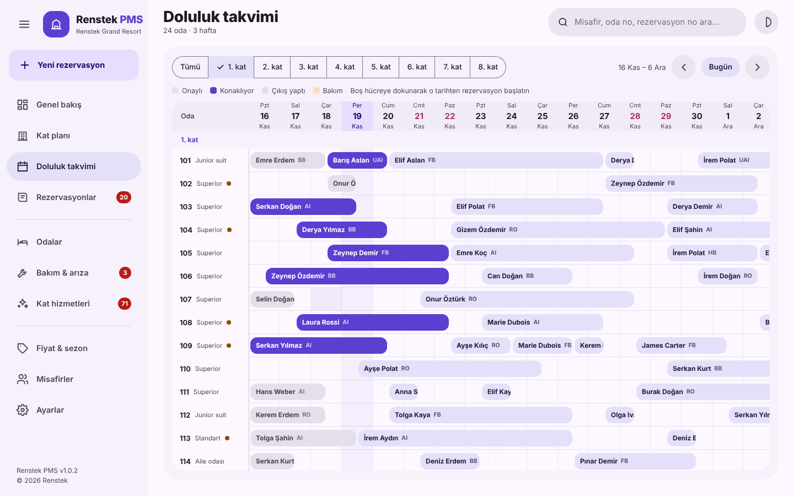
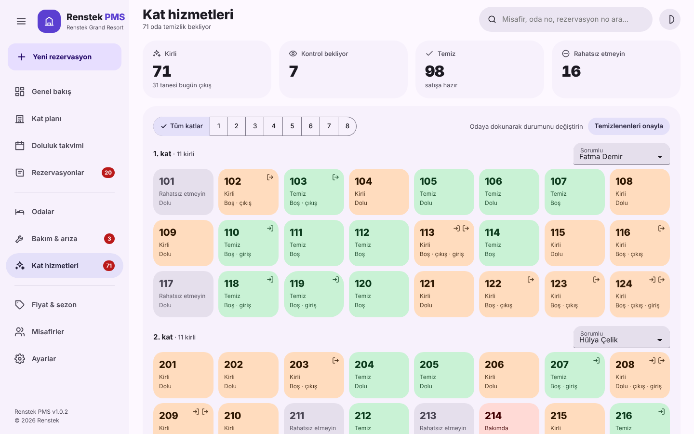
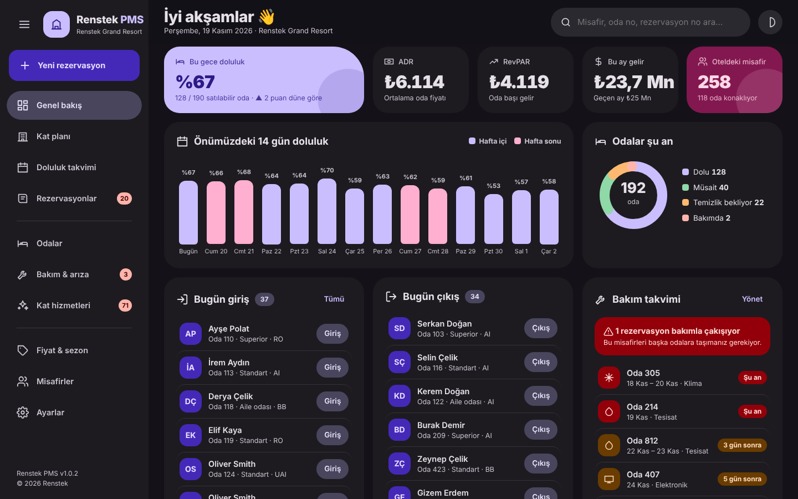

# Renstek PMS

**Renstek** tarafından geliştirilen, büyük oteller için yerel bir otel yönetim sistemi (PMS – Property Management System) ve yönetim paneli. Otelin kat planı üzerinden rezervasyon yapılır; bakım, kat hizmetleri, fiyat ve misafir yönetimi tek bir panelden yürütülür.

> Sürüm: **v1.0.2**

### 🚀 [Canlı demoyu deneyin → tunagirit.github.io/Renstek-PMS](https://tunagirit.github.io/Renstek-PMS/)

Demo her zaman `main` dalındaki en güncel sürümü gösterir. Kurulum gerekmez; tarayıcıda açılır ve örnek bir otelle gelir. Yaptığınız değişiklikler yalnızca sizin tarayıcınızda saklanır, **Ayarlar → Demo veriye sıfırla** ile başa dönebilirsiniz.

| Genel bakış | Kat planı |
|---|---|
|  |  |
| **Bakım & arıza** | **Doluluk takvimi** |
|  |  |
| **Kat hizmetleri** | **Karanlık tema** |
|  |  |

## Modüller

### Genel bakış (otel sahibi paneli)
- Bu geceki doluluk, ADR (ortalama oda fiyatı), RevPAR, bu ayın geliri ve oteldeki misafir sayısı
- Önümüzdeki 14 günün doluluk grafiği, odaların anlık durumu (dolu / müsait / temizlik bekliyor / bakımda)
- Bugünkü girişler ve çıkışlar (tek dokunuşla giriş / çıkış), kanal bazında gelir, tahsil edilmemiş bakiye
- Bakımla çakışan rezervasyon uyarısı ve son işlemler kaydı

### Kat planı ve rezervasyon
- Seçilen katın çizgisel krokisi ve tüm binanın kesit görünümü (her kat, her oda tek bakışta)
- Tarih, yetişkin / çocuk, oda tipi, pansiyon (RO, BB, HB, FB, AI, UAI) seçimi
- Özelliğe göre filtre: deniz manzarası, balkon, jakuzi, engelli erişimi, bağlantılı oda, mutfak, evcil hayvan, sigara
- Birden fazla oda seçimi, alt çubukta canlı toplam; misafir, kanal, kapora ve not ile rezervasyonu tamamlama

### Doluluk takvimi
- Odalar × 3 hafta şerit görünümü; onaylı, konaklayan, çıkış yapmış rezervasyonlar ve bakım blokları
- Boş hücreye dokunarak o tarihten rezervasyon başlatma

### Rezervasyonlar
- Arama (misafir, oda, telefon, kanal, numara), durum ve tarih filtreleri
- Giriş / çıkış, iptal, gelmedi (no-show), tahsilat, tarih değiştirme, oda değiştirme, VIP işaretleme

### Odalar
- 7 oda tipi (Standart, Superior, Deluxe, Aile, Junior suit, Suit, Kral dairesi) ve oda bazında özellikler
- Oda tipini, özelliklerini ve personel notunu düzenleme; toplu seçimle bakım planlama veya tip değiştirme

### Bakım & arıza
- Odaları belirli tarihlerde (örn. `601-604`, 27 Kas – 3 Ara) bakıma alıp satışa kapatma
- Kategori (klima, tesisat, elektrik, mobilya, boya / tadilat, elektronik), öncelik ve teknik sorumlu
- Planlarken çakışan rezervasyonları ve kayıp geliri gösterir; çakışan misafirleri otomatik olarak uygun boş odalara taşır
- Devam eden / planlı / tamamlanan iş emirleri ve ilerleme çubuğu; tamamlanan odalar kontrole düşer

### Kat hizmetleri
- Temiz, kirli, kontrol bekliyor, rahatsız etmeyin durumları; bugün giriş / çıkış işaretleri
- Kat bazında sorumlu personel atama, temizlenenleri toplu onaylama

### Fiyat & sezon
- Oda tipi taban fiyatları ve kapasiteleri, sezonlar (yüzde ile), hafta sonu farkı, çocuk oranı, pansiyon fiyatları
- Önümüzdeki 60 günün fiyat önizlemesi

### Misafirler
- Konaklama sayısı, geceleme, toplam harcama, son konaklama; VIP işaretleme, uyruğa göre dağılım

### Ayarlar
- Otel bilgileri, bina yapısı (kat, sıra, sıradaki oda), personel
- Açık / karanlık / otomatik tema, animasyonlar (açık / cihaza göre / kapalı)
- Veriyi dışa aktarma (yedek), içe aktarma ve demo veriye sıfırlama

## Tasarım

Material 3 Expressive: tonal renk paleti, büyük yuvarlak şekiller, şekil değiştiren butonlar ve odalar, yaylı (spring) hareketler, sayfa geçişleri, sırayla beliren kartlar, sayarak artan göstergeler, büyüyen grafikler, dalga (ripple) efekti ve şekil değiştiren açılış göstergesi. Simgeler dosyanın içine gömülüdür, internet olmadan da görünür.

## Kendi bilgisayarınızda çalıştırma

Kurulum gerektirmez; uygulama tek bir HTML dosyasıdır.

```bash
git clone https://github.com/tunagirit/Renstek-PMS.git
cd Renstek-PMS
```

`index.html` dosyasını tarayıcıda açın. İsterseniz yerel bir sunucuyla da çalıştırabilirsiniz:

```bash
python3 -m http.server 8080
# http://localhost:8080
```

## Veri saklama

Veriler tarayıcının `localStorage` alanında tutulur. İlk açılışta 8 katlı, 192 odalı örnek bir otel ve demo rezervasyonlar yüklenir. **Ayarlar → Veri** bölümünden yedek alıp başka bir bilgisayara aktarabilirsiniz.

## Oda numaralandırma

Oda numarası `kat × 100 + sıra numarası` şeklindedir. Varsayılan yapıda her katta 2 sıra ve sırada 12 oda vardır:

| Sıra | 1. kat | 8. kat |
|---|---|---|
| A blok (deniz cephesi) | 101 – 112 | 801 – 812 |
| B blok | 113 – 124 | 813 – 824 |

## Yol haritası

- [ ] Yerel veritabanı (SQLite) ile çok kullanıcılı çalışma
- [ ] Kullanıcı girişi ve rol bazlı yetki (resepsiyon, kat hizmetleri, teknik servis)
- [ ] Fatura ve folyo yönetimi
- [ ] Kanal yöneticisi entegrasyonu
- [ ] PDF / Excel raporları

## Proje yapısı

```
Renstek-PMS/
├── index.html      # Uygulamanın tamamı (HTML + CSS + JS)
├── docs/           # Ekran görüntüleri
├── CHANGELOG.md
└── README.md
```

---

## Lisans

Bu yazılım lisanslı açık kaynak **değildir**: kaynak kodu yalnızca incelenmek için yayımlanmıştır. Renstek'in yazılı izni olmadan kopyalanamaz, değiştirilemez, ticari amaçla ya da bir işletmede kullanılamaz. Ayrıntılar: [LICENSE](LICENSE).

© 2026 Renstek. Tüm hakları saklıdır.
