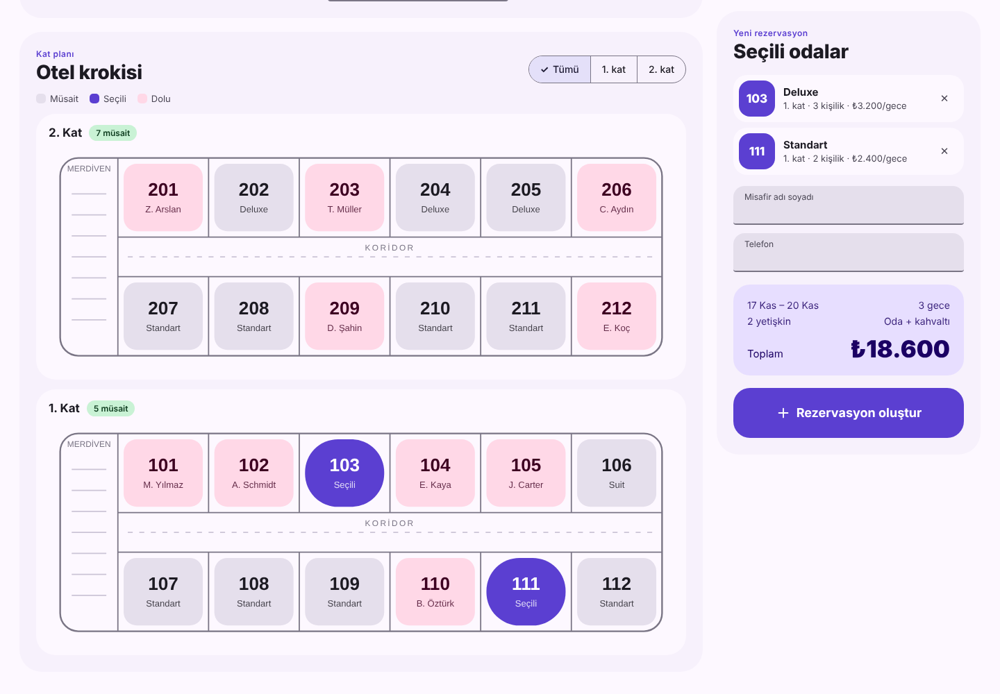

# Renstek PMS

**Renstek** tarafından geliştirilen, otelin kat planı üzerinden rezervasyon yapılan yerel bir otel yönetim sistemi (PMS – Property Management System).



> Sürüm: **v1.0.0**

## Özellikler

- **Otel krokisi:** Otelin her katı çizgilerle çizilmiş basit bir plan olarak görünür. Planda merdiven, ortada bir koridor ve koridorun bir ya da iki yanında oda sıraları bulunur.
- **Durum renkleri:** Odalar seçilen tarih aralığına göre *müsait*, *seçili* veya *dolu* olarak renklenir. Dolu odalarda misafirin adı yazar.
- **Tarih ve misafir:** Giriş ve çıkış tarihi, yetişkin ve çocuk sayısı seçilir. Gece sayısı otomatik hesaplanır.
- **Klasik rezervasyon ayarları:** Oda tipi (Standart, Deluxe, Suit) ve pansiyon tipi (Sadece oda, Oda + kahvaltı, Yarım pansiyon, Tam pansiyon, Her şey dahil) seçilebilir.
- **Çoklu oda rezervasyonu:** Birden fazla oda seçilebilir. Toplam fiyat anında hesaplanır, kapasite yetmezse uyarı verilir.
- **Rezervasyon işlemleri:** Giriş yap, çıkış yap, iptal et.
- **Otel ayarları:** Kat sayısı, kattaki sıra sayısı (1 veya 2), sıradaki oda sayısı ve oda fiyatları değiştirilebilir. Kroki bu ayarlara göre yeniden çizilir.
- **Tasarım:** Material 3 Expressive. Tonal renk paleti, büyük yuvarlak şekiller, dokununca şekil değiştiren oda ve butonlar, yaylı animasyonlar ve Roboto Flex yazı tipi kullanılır.

## Kurulum ve çalıştırma

Kurulum gerektirmez. Uygulama tek bir HTML dosyasından oluşur.

```bash
git clone https://github.com/<kullanici-adi>/Renstek-PMS.git
cd Renstek-PMS
```

`index.html` dosyasını tarayıcıda açmanız yeterlidir. İsterseniz yerel bir sunucuyla da çalıştırabilirsiniz:

```bash
python3 -m http.server 8080
# http://localhost:8080
```

## Veri saklama

v1.0'da veriler tarayıcının `localStorage` alanında tutulur. Bu nedenle:

- Veriler yalnızca uygulamanın açıldığı tarayıcıda görünür.
- Tarayıcı verileri silinirse rezervasyonlar da silinir.
- İlk açılışta örnek (demo) rezervasyonlar yüklenir.

## Oda numaralandırma

Oda numarası `kat × 100 + sıra numarası` şeklinde verilir. Örneğin 2 sıra ve sırada 6 oda olan bir katta:

| Sıra | 1. kat | 2. kat |
|---|---|---|
| A sırası | 101 – 106 | 201 – 206 |
| B sırası | 107 – 112 | 207 – 212 |

A sırasının son odası Suit, A sırasının diğer odaları Deluxe, B sırasının odaları Standart olarak tanımlanır.

## Yol haritası

- [ ] Yerel veritabanı (SQLite) ile çok kullanıcılı çalışma
- [ ] Rezervasyon takvimi (doluluk şeridi)
- [ ] Kat hizmetleri (temiz, kirli, arızalı)
- [ ] Raporlar: doluluk ve gelir
- [ ] Misafir kartı ve fatura

## Proje yapısı

```
Renstek-PMS/
├── index.html          # Uygulamanın tamamı (HTML + CSS + JS)
├── docs/
│   └── ekran-goruntusu.png
├── CHANGELOG.md
└── README.md
```

---

© 2026 Renstek. Tüm hakları saklıdır.
