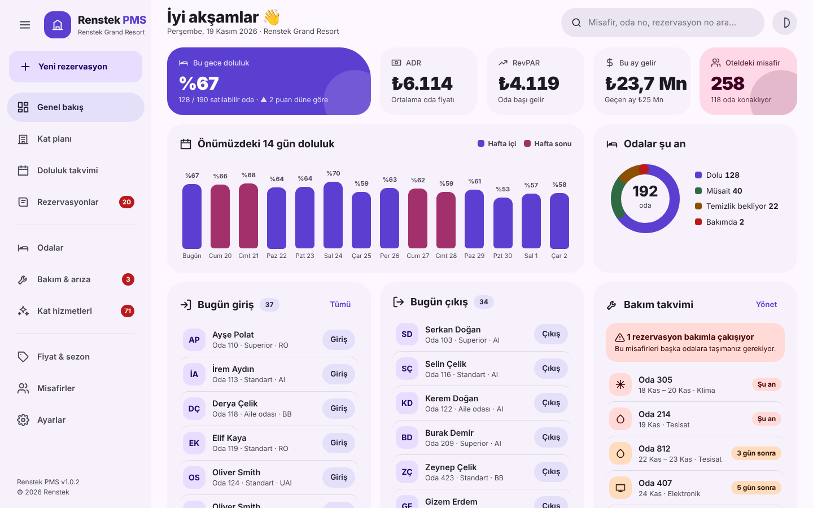
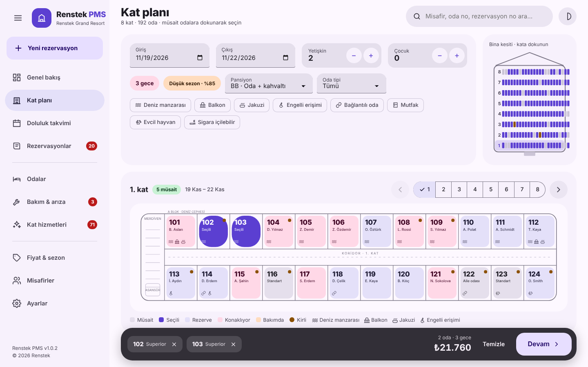
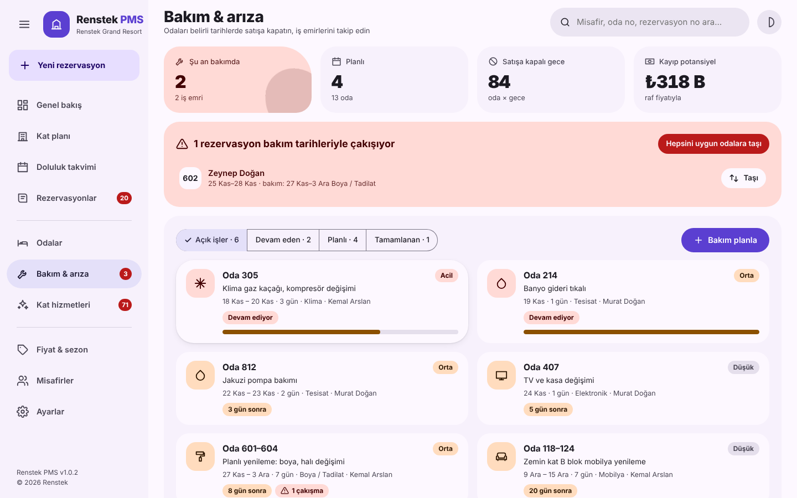

<h1 align="center">🏨 Renstek PMS</h1>

  <b>A hotel management system built around your floor plan.</b> 
  Reservations, maintenance, housekeeping, pricing and guests — one panel for the whole hotel.

  
  &nbsp;
  

  
  
  

  <a href="#english">English</a> · <a href="#türkçe">Türkçe</a>

  
  

---

## 🇬🇧 English

### What is it?
**Renstek PMS** is a property management system for large hotels, developed by **Renstek**. Instead of long room lists, the front desk books straight from the hotel's floor plan: pick the dates, the guests and the room features, tap the rooms, done. The owner gets a live overview of occupancy and revenue; maintenance, housekeeping, pricing and guest history live in the same panel.

The live demo opens with a sample 8-floor, 192-room hotel. Changes you make stay in your own browser only.

### 🧩 Modules
| | |
|---|---|
| 📊 **Owner overview** | Tonight's occupancy, ADR, RevPAR, monthly revenue, guests in house, 14-day occupancy chart, today's arrivals and departures, revenue by channel, open balances. |
| 🗺️ **Floor plan & booking** | Floor sketch and a cross-section of the whole building; filter by sea view, balcony, jacuzzi, accessibility, connecting rooms and more; book several rooms at once with board type, channel and deposit. |
| 📅 **Occupancy calendar** | Rooms × 3 weeks timeline with stays and maintenance blocks; tap an empty cell to start a booking. |
| 🧾 **Reservations** | Search and filters, check-in / check-out, payments, change dates or room, cancel, no-show, VIP. |
| 🛠️ **Maintenance** | Take rooms out of sale for a date range, with category, priority and technician; shows clashing bookings and lost revenue and moves affected guests to free rooms automatically. |
| 🧹 **Housekeeping** | Clean, dirty, inspection and do-not-disturb states; floor supervisors; bulk approval. |
| 💶 **Rates & seasons** | Base rates per room type, seasons, weekend difference, child rate, board prices and a 60-day preview. |
| 👤 **Guests** | Stays, nights, total spend, VIP flag and nationality breakdown. |

### ▶️ Live demo
**https://tunagirit.github.io/Renstek-PMS/**

  
  
  

---

## 🇹🇷 Türkçe

### Nedir?
**Renstek PMS**, **Renstek** tarafından büyük oteller için geliştirilen bir otel yönetim sistemi. Resepsiyon uzun oda listeleri yerine doğrudan otelin kat planı üzerinden rezervasyon yapar: tarihleri, misafirleri ve oda özelliklerini seç, odalara dokun, bitti. Otel sahibi doluluk ve geliri canlı olarak görür; bakım, kat hizmetleri, fiyatlar ve misafir geçmişi aynı panelde yönetilir.

Canlı demo, 8 katlı ve 192 odalı örnek bir otelle açılır. Yaptığın değişiklikler yalnızca senin tarayıcında saklanır.

### 🧩 Modüller
| | |
|---|---|
| 📊 **Sahip paneli** | Bu geceki doluluk, ADR, RevPAR, aylık gelir, oteldeki misafir, 14 günlük doluluk grafiği, bugünkü giriş ve çıkışlar, kanal geliri, tahsil edilmemiş bakiye. |
| 🗺️ **Kat planı ve rezervasyon** | Kat krokisi ve tüm binanın kesiti; deniz manzarası, balkon, jakuzi, engelli erişimi, bağlantılı oda gibi filtreler; pansiyon, kanal ve kapora ile birden fazla odayı tek seferde ayırma. |
| 📅 **Doluluk takvimi** | Oda × 3 hafta şerit görünümü, konaklamalar ve bakım blokları; boş hücreye dokunarak rezervasyon başlatma. |
| 🧾 **Rezervasyonlar** | Arama ve filtreler, giriş / çıkış, tahsilat, tarih ya da oda değiştirme, iptal, gelmedi, VIP. |
| 🛠️ **Bakım ve arıza** | Odaları tarih aralığıyla satışa kapatma; kategori, öncelik ve teknik sorumlu; çakışan rezervasyonları ve kayıp geliri gösterir, etkilenen misafirleri boş odalara otomatik taşır. |
| 🧹 **Kat hizmetleri** | Temiz, kirli, kontrol bekliyor, rahatsız etmeyin durumları; kat sorumluları; toplu onay. |
| 💶 **Fiyat ve sezon** | Oda tipi taban fiyatları, sezonlar, hafta sonu farkı, çocuk oranı, pansiyon fiyatları ve 60 günlük önizleme. |
| 👤 **Misafirler** | Konaklama sayısı, geceleme, toplam harcama, VIP işareti ve uyruğa göre dağılım. |

### 🛣️ Yol haritası
- Çok kullanıcılı çalışma ve rol bazlı yetki (resepsiyon, kat hizmetleri, teknik servis)
- Fatura ve folyo yönetimi
- Kanal yöneticisi entegrasyonu
- PDF / Excel raporları

### ▶️ Canlı demo
**https://tunagirit.github.io/Renstek-PMS/**

---

  © 2026 Renstek · <b>All rights reserved / Tüm hakları saklıdır.</b> 
  The source is public for viewing only — see <a href="LICENSE">LICENSE</a>. · Kaynak kodu yalnızca incelenmek için açıktır — <a href="LICENSE">LICENSE</a>.

